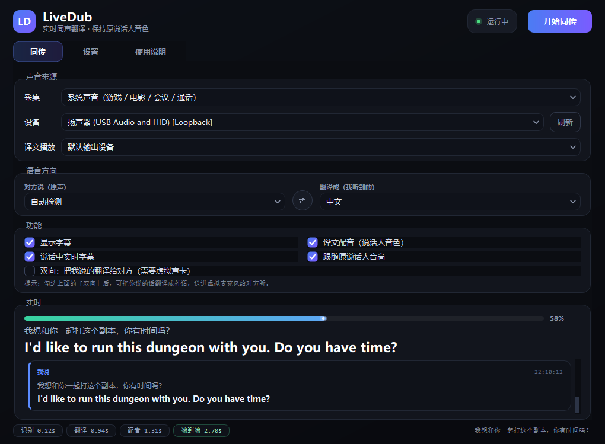
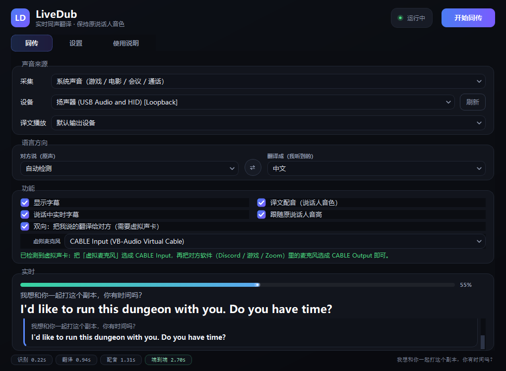
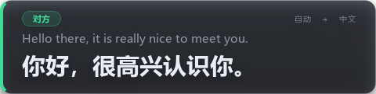

# LiveDub · 实时同声翻译（保留说话人音色）

[](LICENSE)


把**任何正在电脑上播放的声音**（网课、游戏、电影、Discord / Zoom 通话）实时听写成文字、翻译成中文，并用**贴近原说话人音色**的语音念出来；反过来，你说的话也能翻译成英语送进虚拟麦克风，对方直接听懂。

- 采集：WASAPI 环回（系统声音）+ 麦克风
- 识别：SenseVoiceSmall int8（ONNX / CPU，中英日韩粤，约 10 倍实时）
- 翻译：Bing 免费翻译（免 Key）/ DeepSeek API（质量更好，可填 Key）
- 配音：edge-tts 在线神经网络语音，**按原说话人性别与音高自动选音色**
- 界面：PySide6 深色 GUI + 置顶半透明字幕悬浮窗（鼠标可穿透）
- 纯 CPU 可跑：AMD / Intel 核显机器也行，不需要 NVIDIA 显卡





---

## 一、安装（只需一次）

1. 安装 [Python 3.10+](https://www.python.org/downloads/)，安装时**勾选 Add python.exe to PATH**。
2. 双击 **`install.bat`**。脚本会自动：
   - 创建 `.venv` 虚拟环境
   - 用清华镜像装依赖（约 200 MB）
   - 用 hf-mirror 镜像下载模型（约 230 MB）
3. 想「把自己说的话翻译给对方听」，再装一个免费虚拟声卡：[VB-Audio Virtual Cable](https://vb-audio.com/Cable/)（装完重启一次）。

> **装 VB-CABLE 的注意事项**：安装程序可能会把 Windows 的**默认播放设备**改成 `CABLE Input`，
> 那样系统声音全都进了虚拟声卡，你会一点声音都听不到。装完后请检查右下角音量图标，
> 把默认播放设备改回你的扬声器 / 耳机；也可以用项目自带的脚本一键改回：
>
> ```bat
> .venv\Scripts\python.exe -m pip install -i https://pypi.tuna.tsinghua.edu.cn/simple comtypes pycaw
> .venv\Scripts\python.exe tools\fix_default_audio.py --name 扬声器
> ```

装好后：双击 **`start.bat`** 启动（无控制台窗口）。想要桌面图标，右键 `start.bat` → 发送到 → 桌面快捷方式即可；也可以直接把桌面快捷方式指向
`.venv\Scripts\pythonw.exe`，参数填 `main.py`，图标用 `app\ui\assets\icon.ico`。

也可以从 GitHub 克隆：

```bat
git clone https://github.com/chenzy0623/LiveDub.git
cd LiveDub
install.bat
```

> 手动安装（等价）：
> ```
> python -m venv .venv
> .venv\Scripts\python.exe -m pip install -i https://pypi.tuna.tsinghua.edu.cn/simple pyaudiowpatch onnxruntime requests numpy faster-whisper edge-tts miniaudio sherpa-onnx PySide6
> .venv\Scripts\python.exe tools\download_models.py
> ```

---

## 二、三种用法

### 1. 看电影 / 玩游戏 / 上网课 → 只想「听懂」

1. 采集选 **系统声音**，设备选**你正在放声音的那只扬声器（[Loopback]）**
2. 语言方向：对方说 `自动检测` → 翻译成 `中文`
3. 点右上角 **开始同传**

屏幕下方会浮出字幕（英文原文 + 大号中文译文），并配合音色念出中文。字幕窗**鼠标可穿透**，不挡操作；全屏独占的游戏请改成「无边框窗口 / 窗口化」。

### 2. 面对面跟外国人聊天 → 想「听懂 + 让对方听懂」

1. 采集选 **麦克风**（对方对着你的麦克风说话）
2. 勾上 **译文配音**，输出选**耳机**（别和采集的扬声器同一只，否则会互相干扰）
3. 需要你说的话也翻译给对方：勾上 **双向**，见下面第 3 种用法。

### 3. 语音通话（Discord / 游戏内语音 / Zoom）→ 双向同传

装好 VB-CABLE 后：

| 设置项 | 选什么 |
| --- | --- |
| LiveDub「虚拟麦克风」 | `CABLE Input (VB-Audio Virtual Cable)` |
| 对方软件（Discord 等）的麦克风 | `CABLE Output (VB-Audio Virtual Cable)` |
| LiveDub「译文配音」输出 | 你的耳机（**不要**选 CABLE） |
| LiveDub「采集设备」 | 你耳机 / 扬声器的 [Loopback] |

勾上 **双向**。这样：对方说的话 → 你听到中文；你说的话 → 对方听到英语（音色不同但语气语调保留）。

> 这条链路本项目已实测通过：播放中文样本 → 识别 → 翻译 → 英文配音 → 写入 `CABLE Input`，
> 再从 `CABLE Output` 录回来识别，得到的就是翻译后的英文句子。
> 复现命令：`.venv\Scripts\python.exe tools\vb_test.py`

---

## 三、界面说明

| 区域 | 说明 |
| --- | --- |
| 状态胶囊 | `未运行` / `运行中`；旁边是开始/停止按钮 |
| 声音来源 | 采集源（系统声音 / 麦克风）、设备、译文播放设备（只列 WASAPI 端点，避免同一设备重复出现） |
| 语言方向 | 源语言（自动检测 / 中 / 英 / 日 / 韩 / 粤）、目标语言，中间 `⇄` 可交换 |
| 功能 | 显示字幕、译文配音、说话中实时字幕（边听边出字）、跟随原说话人音高、双向（需虚拟声卡） |
| 实时 | 电平表、当前句原文与译文、历史记录（方向色条：绿=对方，蓝=我说） |
| 底部指标 | 识别 / 翻译 / 配音 / 端到端耗时（端到端 < 3 秒会变绿） |

**设置页**：翻译引擎（Bing / DeepSeek + API Key）、上文参考条数、语音识别模型与线程数、配音音色与语速、字幕字号与不透明度、快捷键。

**快捷键**：`Ctrl+Alt+S` 开始/停止，`Ctrl+Alt+H` 显示/隐藏字幕。关闭窗口默认最小化到托盘（可在设置里改）。

---

## 四、延迟与性能（本机实测：Xeon E5-2673 v3，纯 CPU）

| 环节 | 耗时 |
| --- | --- |
| 语音识别 SenseVoiceSmall int8 | 0.15 – 0.35 s |
| 翻译（Bing 免费） | 0.8 – 1.2 s |
| 配音（edge-tts 合成 + 解码） | 1.1 – 1.9 s |
| **端到端（说完到出声）** | **约 2.4 – 3.4 s** |

- 只开字幕不开配音，可再省 1.5 秒左右。
- 说话中实时字幕（partial）大约 0.4 秒刷新一次，用于「边听边看」。
- 首次启动需要预热（加载模型 + 翻译握手），约 4 – 6 秒，之后进入稳态。

---

## 五、音色是怎么「不变」的

本机没有 NVIDIA 显卡，跑不动 GPT-SoVITS / RVC 这类声音克隆模型，所以采用**音高 + 性别匹配**：

1. 用自相关算法估计原说话人的基频 F0（`app/audio/pitch.py`）
2. 按 F0 判定男声 / 女声，从 edge-tts 音色表里挑最接近的神经语音
3. 合成时做音高偏移，让译文的声线贴近原说话人

听起来「像同一个人在说中文」，但不是 1:1 克隆。若要真·克隆，可接云服务（ElevenLabs、MiniMax、火山引擎），在 `app/tts/engine.py` 的 `CloneTTS` 里填入 API 即可。

---

## 六、目录结构

```
LiveDub/
├─ main.py                  入口（python main.py）
├─ start.bat / install.bat  启动 / 一键安装
├─ app/
│  ├─ config.py             配置（%APPDATA%\LiveDub\config.json）
│  ├─ audio/                设备枚举、WASAPI 采集/播放、重采样、音高
│  ├─ asr/                  SenseVoice（默认）/ faster-whisper
│  ├─ mt/                    Bing 免费 / DeepSeek / NLLB 离线 / 直通
│  ├─ tts/                   edge-tts 音色选择与合成
│  ├─ pipeline/engine.py    采集→VAD→识别→翻译→配音→播放 主流程
│  └─ ui/                   主窗口、字幕悬浮窗、主题、全局热键、图标
├─ models/                  sensevoice/ 与 silero_vad.onnx
├─ tools/
│  ├─ download_models.py    模型下载（hf-mirror）
│  ├─ run_cli.py            无界面测试（播放样本 → 打印字幕与延迟）
│  ├─ smoke.py              分项自检（设备 / 环回 / VAD / ASR / TTS / MT）
│  ├─ bench_asr.py          识别速度基准
│  ├─ vb_test.py            VB-CABLE 出站链路自测（中→英→虚拟麦克风）
│  ├─ fix_default_audio.py  把 Windows 默认播放设备改回扬声器
│  └─ make_icon.py          生成应用图标
└─ shots/                   界面截图
```

## 七、自检与排错

```bat
:: 分项自检（设备、环回采集、VAD、识别、翻译、配音）
.venv\Scripts\python.exe tools\smoke.py

:: 端到端：播放英文样本 → 环回采集 → 打印字幕与延迟
.venv\Scripts\python.exe tools\run_cli.py --file models\sample_en.mp3 --voice

:: 出站链路自测（中文样本 → 英文 → 写入 VB-CABLE，再从 CABLE Output 录回来识别）
.venv\Scripts\python.exe tools\vb_test.py

:: 重新下载模型
.venv\Scripts\python.exe tools\download_models.py --force
```

常见问题：

| 现象 | 处理 |
| --- | --- |
| 没有声音 / 采集不到 | 确认「设备」选的是**正在播放声音的那只扬声器的 [Loopback]**；先放点音乐看电平表有没有动 |
| 译文被自己又翻译一遍 | 程序会在文本层做回声判定（同时间窗 + 文本相似度高就丢弃）；仍出现就把「译文播放」选到**耳机**，和采集的扬声器分开 |
| 翻译报错 / 超时 | Bing 免费接口偶发限流，等几秒自动重试；或在设置里改用 DeepSeek（需填 API Key） |
| 字幕没出现 | 全屏独占游戏不支持悬浮窗，改成无边框窗口；或按 `Ctrl+Alt+H` |
| 说话识别成乱码 / 一直出 `period` | 环境噪音过大，调低麦克风增益；程序已过滤静音处幻觉文本 |
| 缺少模型提示 | 运行 `tools\download_models.py` |

## 八、已知限制

- 「说话中实时字幕」为预览性质，最终译文以整句结果为准。
- 无 GPU 时不做本地声音克隆；离线翻译（NLLB）已留有接口但默认不启用，模型需自行下载。
- 仅支持 Windows（依赖 WASAPI 环回采集）。

## 九、开源协议

MIT License · 欢迎 Issue / PR。

- 语音识别：[sherpa-onnx](https://github.com/k2-fsa/sherpa-onnx) + [SenseVoice](https://github.com/FunAudioLLM/SenseVoice)
- 语音合成：Microsoft edge-tts（在线，免费）
- 翻译：可选 Bing 免费接口 / DeepSeek API / NLLB 离线
- 虚拟声卡：[VB-Audio Virtual Cable](https://vb-audio.com/Cable/)

> 本项目仅用于个人学习与跨语言交流辅助，请遵守各平台服务条款。
